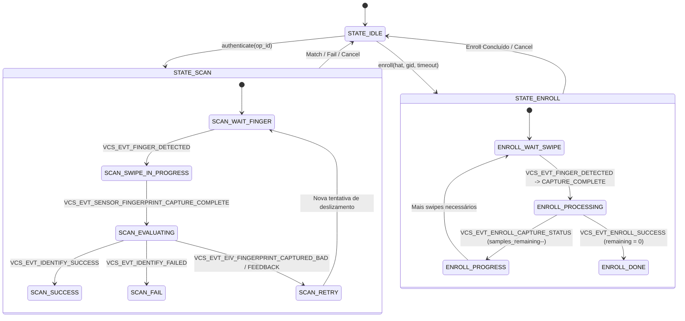

# Arquitetura da Stack Biométrica Validity VFS61xx (k3gxx)

## 1. Visão Geral
Este documento descreve a arquitetura da stack biométrica do sensor de deslizamento (swipe) **Validity / Synaptics VFS61xx** integrado no **Samsung Galaxy S5 3G (SM-G900H / `k3gxx`)** no contexto do **LineageOS 18.1 (Android 11)**.

Historicamente, a implementação de impressão digital neste aparelho dependia de:
1. `vcsFPService` (daemon nativo executando em background, comunicando-se com o TrustZone/MobiCore via `libvfmtztransport.so`).
2. `ValidityService.apk` (aplicativo de sistema Java legado que instanciava o serviço em segundo plano).
3. `libvcsfp.so` (biblioteca JNI que ligava o Java à `libvfmClient.so`).
4. Sockets IPC locais (`validityservice` e `validityservice_callback`).
5. HAL legada em C (`hal/fingerprint.c`, API 2.0) que fazia parsing de strings ASCII via sockets.

O objetivo da modernização é eliminar completamente o `ValidityService.apk`, a camada JNI e os sockets locais legados, substituindo-os por uma **HAL HIDL 2.1 C++ nativa moderna (`IBiometricsFingerprint`)** que consome diretamente as interfaces de `libvfmClient.so`.

---

## 2. Topologia do Pipeline de Execução

```
+-------------------------------------------------------------------+
|               Android Framework (BiometricService)                |
+-------------------------------------------------------------------+
                                  |
                                  | HIDL 2.1 (hwbinder)
                                  v
+-------------------------------------------------------------------+
|  android.hardware.biometrics.fingerprint@2.1-service.universal5422|
|  - BiometricsFingerprint (service/BiometricsFingerprint.cpp)      |
|  - VcsClientWrapper (src/VcsClientWrapper.cpp)                    |
|  - Implementa vcs::IListener                                      |
+-------------------------------------------------------------------+
                                  |
                                  | Chamadas C++ nativas
                                  v
+-------------------------------------------------------------------+
|  libvfmClient.so                                                  |
|  - vcs::CreateInterface / vcs::DestroyInterface                   |
|  - vcs::CAPIHandlerClient / vcs::IValidity                        |
|  - vcs::CPipe (comunicação via named pipes em /dev/validity/)     |
+-------------------------------------------------------------------+
                                  |
                                  | Named Pipes (/dev/validity/*)
                                  v
+-------------------------------------------------------------------+
|  vcsFPService (Daemon do Sensor)                                  |
|  - Controle de hardware e processamento preliminar                |
|  - Carrega libvfmtztransport.so e libvalAuth.so                   |
+-------------------------------------------------------------------+
                                  |
                                  | DCI Buffer / MobiCore Driver
                                  v
+-------------------------------------------------------------------+
|  MobiCore TrustZone Secure OS                                     |
|  - Trustlet de biometria Validity                                 |
|  - Matching criptográfico seguro e armazenamento de templates     |
+-------------------------------------------------------------------+
```

---

## 3. Máquina de Estados e Ciclo de Vida do Sensor Swipe

Diferente de sensores modernos de toque capacitivo ("touch"), o Validity VFS61xx é um sensor de deslizamento ("swipe"). O ciclo de captura requer movimento contínuo do dedo sobre a área do sensor sob velocidade e pressão controladas.

### 3.1 Estados de Operação da HAL
- **`STATE_IDLE`**: Sensor em repouso / baixo consumo. Aguarda solicitação do framework.
- **`STATE_ENROLL`**: Sessão de cadastro ativa. O usuário deve deslizar o dedo repetidas vezes (normalmente 8 a 10 swipes válidos) até acumular cobertura angular e minúcias suficientes.
- **`STATE_SCAN` (Authenticate / Identify)**: Sessão de autenticação ativa. O sensor aguarda a detecção do dedo e o deslizamento completo para extração e envio ao TrustZone.
- **`STATE_CANCELING`**: Transição de parada solicitada via `cancel()`. O wrapper sinaliza cancelamento à `libvfmClient.so` e retorna a `STATE_IDLE`.

### 3.2 Diagrama de Transição de Estados de Captura



---

## 4. Mapeamento de Eventos e Qualidade de Imagem

Durante um deslizamento, o sensor emite eventos granulares que devem ser convertidos em `acquiredInfo` ou `error` do HIDL:
- **`VCS_EVT_FINGER_DETECTED`**: Dedo detectado no sensor. Emite `FINGERPRINT_ACQUIRED_TOUCH_DETECTED` ou inicia buffer.
- **`VCS_EVT_SWIPE_SPEED_UPDATE` / `VCS_IMAGE_QUALITY_TOO_FAST`**: Deslizamento excessivamente rápido. Traduz para `FINGERPRINT_ACQUIRED_TOO_FAST`.
- **`VCS_IMAGE_QUALITY_TOO_SLOW`**: Deslizamento lento demais. Traduz para `FINGERPRINT_ACQUIRED_TOO_SLOW`.
- **`VCS_IMAGE_QUALITY_BAD_SWIPE` / `VCS_IMAGE_QUALITY_PARTIAL_TOUCH`**: Captura parcial ou incompleta. Traduz para `FINGERPRINT_ACQUIRED_PARTIAL`.
- **`VCS_IMAGE_QUALITY_SOMETHING_ON_THE_SENSOR`**: Sensor sujo. Traduz para `FINGERPRINT_ACQUIRED_INSUFFICIENT`.
- **`VCS_EVT_IDENTIFY_SUCCESS`**: Identificação concluída com sucesso. Traduz para `onAuthenticated(fid, token)`.
- **`VCS_EVT_IDENTIFY_FAILED`**: Nenhuma correspondência encontrada. Traduz para `onAuthenticated(0, empty_token)`.
- **`VCS_EVT_ENROLL_CAPTURE_STATUS`**: Atualização do progresso da matrícula com status de cobertura.
- **`VCS_EVT_ENROLL_SUCCESS`**: Matrícula finalizada com template persistido no TrustZone.
