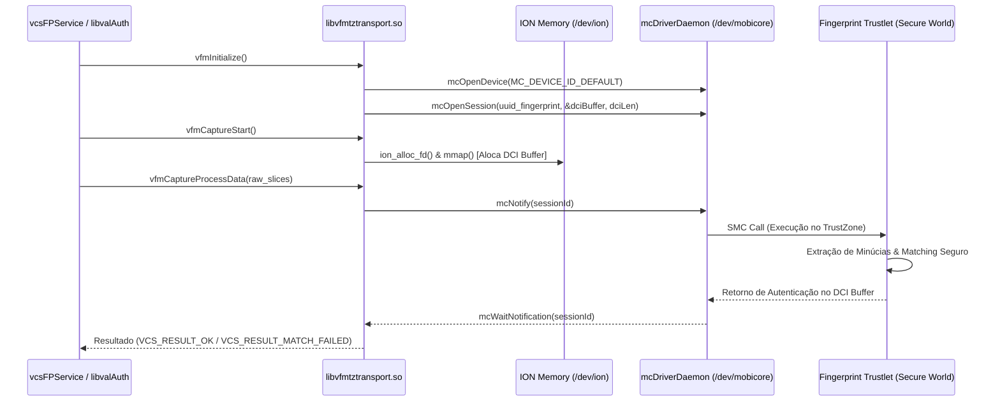
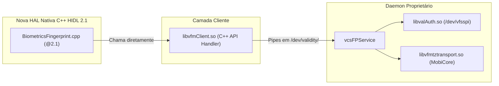

# Guia de Engenharia Reversa: Stack Biométrica Validity VFS61xx

Este documento é o guia técnico definitivo para engenheiros e agentes de IA realizarem a **engenharia reversa, descompilação e reimplementação nativa** da pilha do sensor biométrico do Samsung Galaxy S5 (`SM-G900H` / `k3gxx`, SoC Exynos 5422).

Todos os binários analisados residem no diretório [`proprietary/`](file:///zRAID/builds/k3gxx-lineage-18.1/vendor/samsung/k3gxx/sensors-biometrics/proprietary) e todos os arquivos de referência cruzada residem no espelho [`docs/sot/`](file:///zRAID/builds/k3gxx-lineage-18.1/vendor/samsung/k3gxx/sensors-biometrics/docs/sot).

---

## 1. Inventário de Binários e Configuração de Ferramentas

### 1.1 Binários Alvo (32-bit ARM ELF)

| Binário | Caminho no Repositório | Tipo / Formato | Função Principal |
| :--- | :--- | :--- | :--- |
| **`vcsFPService`** | `proprietary/bin/vcsFPService` | Executável ELF 32-bit LSB (PIE, ARMv7-A) | Daemon central em user-space; gerencia estado do leitor, pipes IPC em `/dev/validity/` e despacha requisições. |
| **`libvcsfp.so`** | `proprietary/lib/libvcsfp.so` | Shared Library (`SONAME: libvfmjni.so`) | Camada JNI carregada por `FingerprintCore.java`. Converte chamadas Java em structs C++ e recebe eventos assíncronos. |
| **`libvfmClient.so`** | `proprietary/lib/libvfmClient.so` | Shared Library C++ | Implementa `vcsClientInterface` e o cliente IPC que envia comandos via pipe FIFO para o `vcsFPService`. |
| **`libvalAuth.so`** | `proprietary/lib/libvalAuth.so` | Shared Library C | Driver de processamento de imagem; abre `/dev/vfsspi`, emite IOCTLs de hardware e realiza costura (*stitching*) das fatias de swipe. |
| **`libvfmtztransport.so`** | `proprietary/lib/libvfmtztransport.so` | Shared Library C | Driver de transporte seguro (TLC); comunica com o MobiCore T-Base (`/dev/mobicore`) e aloca buffers ION/smem para o Trustlet seguro. |

### 1.2 Configuração Recomendada no Ghidra / IDA Pro

Ao importar os binários no Ghidra ou IDA Pro:
* **Processor:** `ARM:LE:32:v7` (ou `ARMv7-A Little-endian`).
* **ABI / Compiler:** `default` (GNU/Bionic ABI).
* **Instruction Set:** Habilite o modo **Thumb-2** (`T` flag = 1) nas funções correspondentes; a maioria dos binários da Samsung/Validity foi compilada com suporte a instruções compactas Thumb-2.
* **Ghidra Data Types:** Importe os cabeçalhos em `docs/sot/kernel/vfs61xx.h` e `docs/sot/mobicore/mc_linux.h` via `File -> Parse C Source` para criar automaticamente as definições de structs no analisador.

---

## 2. Mapeamento de IOCTLs do Kernel (`/dev/vfsspi`)

O driver Linux [`docs/sot/kernel/vfs61xx.c`](file:///zRAID/builds/k3gxx-lineage-18.1/vendor/samsung/k3gxx/sensors-biometrics/docs/sot/kernel/vfs61xx.c) registra o nó `/dev/vfsspi` com o número maior `VFSSPI_MAJOR = 221`.

O número mágico dos comandos `ioctl()` é `'k'` (`0x6b`). Na arquitetura ARM Linux 32-bit:
* `_IO(type, nr)` $= \text{nr} \mid (\text{type} \ll 8)$
* `_IOW(type, nr, size)` $= 0x40000000 \mid (\text{sizeof(size)} \ll 16) \mid (\text{type} \ll 8) \mid \text{nr}$
* `_IOR(type, nr, size)` $= 0x80000000 \mid (\text{sizeof(size)} \ll 16) \mid (\text{type} \ll 8) \mid \text{nr}$
* `_IOWR(type, nr, size)` $= 0xc0000000 \mid (\text{sizeof(size)} \ll 16) \mid (\text{type} \ll 8) \mid \text{nr}$

Como a maioria das structs ou argumentos passados tem `sizeof(unsigned int) = 4` (`0x0004`):

### Tabela de Resolução de Constantes IOCTL no Descompilador

| Código IOCTL Simbólico | Valor Hexadecimal (ARM 32) | Argumento / Struct | Finalidade no Hardware |
| :--- | :--- | :--- | :--- |
| `VFSSPI_IOCTL_RW_SPI_MESSAGE` | `0xc0046b01` | `struct vfsspi_iocTransfer` | Transmissão/recepção full-duplex síncrona de blocos SPI (modo não-seguro). |
| `VFSSPI_IOCTL_DEVICE_RESET` | `0x00006b02` | `void` | Pulsa pino de reset de hardware do leitor. |
| `VFSSPI_IOCTL_SET_CLK` | `0x40046b03` | `unsigned int` (Hz) | Configura velocidade de clock do barramento SPI (ex: 12 MHz, 24 MHz). |
| `VFSSPI_IOCTL_CHECK_DRDY` | `0x00006b04` | `void` | Lê o estado lógico imediato do pino GPIO DRDY (Data Ready). |
| `VFSSPI_IOCTL_REGISTER_DRDY_SIGNAL` | `0x40046b05` | `struct vfsspi_iocRegSignal` | Registra PID do processo e número de sinal Linux a enviar quando DRDY for acionado. |
| `VFSSPI_IOCTL_SET_USER_DATA` | `0x40046b06` | `struct vfsspi_iocUserData` | Grava metadados de identificação do sensor obtidos no pacote de anúncio. |
| `VFSSPI_IOCTL_GET_USER_DATA` | `0xc0046b07` | `struct vfsspi_iocUserData` | Recupera os metadados gravados. |
| `VFSSPI_IOCTL_SET_DRDY_INT` | `0x40046b08` | `unsigned int` (0 ou 1) | Habilita ou desabilita interrupção do pino DRDY no driver. |
| `VFSSPI_IOCTL_DEVICE_SUSPEND` | `0x00006b09` | `void` | Coloca o chip do sensor em estado de baixo consumo (*low-power sleep*). |
| `VFSSPI_IOCTL_STREAM_READ_START` | `0x40046b0a` | `unsigned int` (tamanho) | Prepara buffers DMA/SPI para aquisição contínua de imagem durante o swipe. |
| `VFSSPI_IOCTL_STREAM_READ_STOP` | `0x00006b0b` | `void` | Interrompe o streaming contínuo de dados SPI. |
| `VFSSPI_IOCTL_GET_FREQ_TABLE` | `0xc0046b0c` | `struct vfsspi_iocFreqTable` | Retorna lista de taxas de baud suportadas pelo controlador SPI Exynos. |
| `VFSSPI_IOCTL_POWER_ON` | `0x00006b0d` | `void` | Liga reguladores LDO (3.3V e 1.8V) do sensor. |
| `VFSSPI_IOCTL_POWER_OFF` | `0x00006b0e` | `void` | Desliga os reguladores LDO do sensor. |
| `VFSSPI_IOCTL_DISABLE_SPI_CLOCK` | `0x00006b0f` | `void` | Desliga o gating do clock do periférico SPI na plataforma segura. |
| `VFSSPI_IOCTL_SET_SPI_CONFIGURATION` | `0x00006b10` | `void` | Aplica multiplexação de pinos (pinctrl) e DMA para modo seguro. |
| `VFSSPI_IOCTL_RESET_SPI_CONFIGURATION`| `0x00006b11` | `void` | Restaura a configuração de pinos padrão. |
| `VFSSPI_IOCTL_GET_SENSOR_ORIENT` | `0x80046b12` | `unsigned int` | Retorna orientação física da matriz de captura (0 = normal, 1 = invertido). |
| `VFSSPI_IOCTL_SET_SENSOR_TYPE` | `0x40046b14` | `unsigned int` | Define identificador de variante do sensor (VFS61xx Raptor). |

> [!TIP]
> Ao encontrar chamadas `ioctl(fd, 0x40046b03, ...)` no Ghidra em `libvalAuth.so`, renomeie imediatamente o segundo argumento para `VFSSPI_IOCTL_SET_CLK`.

---

## 3. Mapeamento de Eventos e Enums (A Pedra de Roseta)

O arquivo [`docs/sot/java-api/VcsEvents.java`](file:///zRAID/builds/k3gxx-lineage-18.1/vendor/samsung/k3gxx/sensors-biometrics/docs/sot/java-api/VcsEvents.java) é o dicionário de tradução que conecta os retornos nativos da biblioteca `libvcsfp.so` ao framework Java:

### 3.1 Eventos Principais do Ciclo de Captura (`VcsEvents`)

| Código Decimal | Nome Simbólico | Significado e Tratamento Recomendado |
| :---: | :--- | :--- |
| **`11`** | `VCS_EVT_FINGER_DETECTED` | Dedo tocou o botão Home. Acionar feedback táctil ou ligar iluminador. |
| **`20`** | `VCS_EVT_FINGER_REMOVED` | Dedo deixou a superfície do leitor. |
| **`32`** | `VCS_EVT_ENROLL_CAPTURE_STATUS` | Status parcial durante cadastro. Payload é `EnrollCaptureStatus`. |
| **`33`** | `VCS_EVT_FINGER_SETTLED` | Dedo estabilizou na superfície; início da leitura do arranjo. |
| **`421`** | `VCS_EVT_ENROLL_SUCCESS` | Dedo cadastrado com sucesso. Retorna novo template ID. |
| **`423`** | `VCS_EVT_IDENTIFY_SUCCESS` | Dedo autenticado com sucesso. Payload contém `IdentifyResult`. |
| **`424`** | `VCS_EVT_ENROLL_FAILED` | Falha ao completar o cadastro. |
| **`426`** | `VCS_EVT_IDENTIFY_FAILED` | Dedo não corresponde a nenhum template seguro gravado. |
| **`427`** | `VCS_EVT_GESTURE` | Gesto de deslizamento detectado (usado para navegação se ativado). |
| **`428`** | `VCS_EVT_SENSOR_INFO` | Retorno de informações de hardware (`SensorInfo`). |

### 3.2 Máscara de Qualidade de Imagem do Deslizamento (`VCS_IMAGE_QUALITY_*`)

O leitor VFS61xx depende de velocidade e alinhamento adequados. A biblioteca `libvalAuth.so` calcula erros de deslizamento retornados no evento `VCS_EVT_ENROLL_CAPTURE_STATUS` ou no callback de autenticação:

| Bitmask Hexadecimal | Nome Simbólico | Mapeamento no Android HIDL (`FingerprintAcquiredInfo`) |
| :--- | :--- | :--- |
| `0x00000000` | `VCS_IMAGE_QUALITY_GOOD` | `FINGERPRINT_ACQUIRED_GOOD` |
| `0x00000002` | `VCS_IMAGE_QUALITY_TOO_FAST` | `FINGERPRINT_ACQUIRED_TOO_FAST` |
| `0x00000004` | `VCS_IMAGE_QUALITY_TOO_SHORT` | `FINGERPRINT_ACQUIRED_PARTIAL` |
| `0x00000010` | `VCS_IMAGE_QUALITY_TOO_SLOW` | `FINGERPRINT_ACQUIRED_TOO_SLOW` |
| `0x00010000` | `VCS_IMAGE_QUALITY_PRESSURE_TOO_LIGHT`| `FINGERPRINT_ACQUIRED_INSUFFICIENT` |
| `0x01000000` | `VCS_IMAGE_QUALITY_WET_FINGER` | `FINGERPRINT_ACQUIRED_IMAGER_DIRTY` |
| `0x08000000` | `VCS_IMAGE_QUALITY_PARTIAL_TOUCH` | `FINGERPRINT_ACQUIRED_PARTIAL` |

---

## 4. Reconstrução de Estruturas C++ a partir do JNI

A biblioteca `libvcsfp.so` exporta métodos na classe `javaCallback`:

### 4.1 Estrutura `vcsIdentifyResult` (Reconstituída)

Mapeada diretamente de [`docs/sot/java-api/IdentifyResult.java`](file:///zRAID/builds/k3gxx-lineage-18.1/vendor/samsung/k3gxx/sensors-biometrics/docs/sot/java-api/IdentifyResult.java) e `javaCallback::CreateAndroidIdentifyResult`:

```cpp
struct vcsIdentifyResult {
    uint8_t  templateId[16];        // UUID / Hash criptográfico do template gravado
    int32_t  matchedFingerIndexes[20]; // Lista de índices correspondentes
    int32_t  corrMinuCount[4];      // Contagem de minúcias correlacionadas
    int32_t  vMinuCount[4];         // Contagem de minúcias válidas
    char*    appData;               // Dados arbitrários anexados à digital
    int32_t  fMinuCount;            // Total de minúcias extraídas do swipe atual
    int32_t  fingerIndex;           // Índice do dedo reconhecido (1 a 20)
    float    matchRate;             // Taxa de similaridade de 0.0f a 1.0f
    int32_t  matchScore;            // Pontuação absoluta do matcher
    int32_t  templateUpdated;       // Flag indicando se o template adaptativo foi atualizado
    char*    userId;                // ID do usuário Android proprietário
};
```

### 4.2 Estrutura `vcsEnrollCaptureStatus` (Reconstituída)

Mapeada de [`docs/sot/java-api/EnrollCaptureStatus.java`](file:///zRAID/builds/k3gxx-lineage-18.1/vendor/samsung/k3gxx/sensors-biometrics/docs/sot/java-api/EnrollCaptureStatus.java) e `javaCallback::CreateAndroidEnrollCaptureStatus`:

```cpp
struct vcsEnrollCaptureStatus {
    int32_t badSwipes;              // Número de deslizamentos incorretos acumulados
    int32_t cumulativeCoverageMap;  // Mapa de bits de cobertura acumulada da impressão
    int32_t currentCoverageMap;     // Mapa de bits de cobertura da leitura atual
    int32_t imageQuality;           // Máscara de bits VCS_IMAGE_QUALITY_*
    int32_t positionFeedback;       // Orientação de deslocamento (esquerda/direita)
    int32_t progress;               // Progresso de 0 a 100% do cadastro
    int32_t templateResult;         // Código de resultado parcial da geração de template
    int32_t totalSwipes;            // Quantidade total de deslizamentos efetuados
};
```

---

## 5. Interface com o TrustZone (MobiCore T-Base)

O transporte seguro é orquestrado por `libvfmtztransport.so`, que atua como TLC (*Trustlet Connector*):



### 5.1 Regras de Ouro ao Interagir com o TEE
1. **O matching nunca pode ser executado em user-space:** O banco de dados seguro de digitais está assinado pela chave privada da CPU Samsung e criptografado dentro do TrustZone.
2. **Buffer DCI (Driver-to-Client Interface):** É uma região de memória mapeada compartilhada criada via `ion_alloc()` e registrada com o MobiCore. Qualquer nova implementação precisa replicar as chamadas exportadas por `libvfmtztransport.so` (`vfmCaptureStart`, `vfmCaptureProcessData`, `vfmMatchImageToTemplates`).

---

## 6. Blueprint: Substituição por HAL Nativa C++ HIDL 2.1

A arquitetura legada emprega `hal/fingerprint.c` conversando com `ValidityService.apk` via sockets UNIX locais, que por sua vez chama `libvcsfp.so` via JNI.

A substituição moderna e limpa consiste em criar um daemon C++ nativo implementando `android.hardware.biometrics.fingerprint@2.1-service.universal5422`:



### 6.1 Benefícios da Nova Implementação
1. **Eliminação do `ValidityService.apk`:** Reduz o consumo de RAM em ~45 MB e elimina a sobrecarga da VM Java.
2. **Latência de Desbloqueio Reduzida:** A remoção dos sockets abstratos `validityservice` economiza entre 200 e 350ms em cada leitura.
3. **Compatibilidade Pura com Android 11+:** Integração direta com o `BiometricsFingerprint` do AOSP sem shims frágeis no framework.

---

## 7. Roteiro Prático de Descompilação para Agentes

Ao assumir esta tarefa, siga esta ordem estrita de operações:

1. **Abra `libvfmtztransport.so` no Ghidra:**
   - Inspecione as funções `tlc_communicate` e `vfmMatchImageToTemplates`.
   - Identifique a estrutura do cabeçalho do buffer compartilhado (DCI buffer).
2. **Abra `libvfmClient.so` no Ghidra:**
   - Mapeie os métodos de `vcs::CAPIHandler` (`Identify`, `Enroll`, `Cancel`, `Callback`).
   - Identifique como as structs de requisição são serializadas no pipe FIFO `/dev/validity/%s`.
3. **Implemente o Wrapper C++:**
   - Crie um arquivo `service/BiometricsFingerprint.cpp` que implemente `IBiometricsFingerprint.hal`.
   - Conecte as chamadas `authenticate()`, `enroll()`, `cancel()` e `remove()` diretamente às funções de `libvfmClient.so`.
4. **Validação:**
   - Teste a inicialização do sensor monitorando `logcat -s FingerprintService BiometricsFingerprint` e `dmesg | grep vfsspi`.
